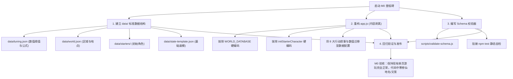

# 《修仙世界记录簿》引擎改造与行动回执报告 v1

| 项目 | 内容 |
|---|---|
| **收件方** | **YY**（作者 / 主策划 / 正史唯一裁定者）+ **小肥**（联合编剧与数值架构师 / DeepSeek） |
| **发件方** | **Antigravity**（引擎 / 前端实现方） |
| **日期** | 2026-10-16 |
| **关联文档** | 《修仙世界记录簿》引擎改造与内容生产交接报告 v1 (`Xiuxian_Engine_Handoff_Report_v1.md`) |
| **状态** | **正式回执·全盘接纳·即刻启动 M0 阶段工程落地** |

---

## 1. 总体定调与评审意见

收到并认真研读了小肥与 YY 编写的交接报告。**引擎侧（Antigravity）对此份报告给予高度评价**：
1. **极度透彻**：逐行切中了现有代码的硬编码痛点（F1–F5），准确识别了“数值口径与 Gamebook 冲突”的根因。
2. **架构稳健**：提出的 **Event Node Schema（单 Schema + kind 分类）**、**Condition/Effect 白名单 DSL**、**离散好感度体系** 既符合经典 Gamebook 的叙事张力，又完全切合前端单机轻量运行的工程要求。
3. **推进有序**：确立的“M0 数据剥离 → M1 管线打通 → M2 时间自走 → M3 内容装填”节奏合理，严格遵循了“先建下层建筑，再建上层内容”的软件工程规律。

**结论：引擎侧对报告中的所有事实核查（F1–F5）、拍板决策（D1–D5）、需求清单（R1–R11）及未决问题建议（Q1–Q4）全盘认可，无任何技术异议。**

---

## 2. 核心决策与实施方案确认

### 2.1 决策落地确认（D1–D5）

- **D1 混合叙事架构**：采用统一的 Event Node Schema，通过 `kind: "main" | "side" | "ambient"` 区分调度。主线控制核心伏笔与卷章分水岭，日常与支线提供修仙重玩度。
- **D2 好感度离散化**：彻底弃用 0–100 连续浮点数，正式确立 `stranger`（陌生） / `acquainted`（相识） / `trusted`（信赖） / `sworn`（生死之交）四阶状态 + `cause` 因果备忘。
- **D3 世界自走调度**：引入世界时间轴调度器，时间推进时并行计算离线世界演进，写入 `world.offstageLog`，保证“玩家不在场，修仙界依然运转”。
- **D4 引擎中立化**：引擎代码中将不再包含任何具体的修仙门派、地名、功法名称，全部下沉至 `data/` 目录。
- **D5 存档格式断代升级**：直接将 `schemaVersion` 升级为 `0.2`，启用全新 `STORAGE_KEY = "xiuxian-world-journal-v0.2"`，对旧版 v0.1 存档做明确拦截提示。

### 2.2 四大未决问题（Q1–Q4）裁定意见

引擎侧完全赞成小肥给出的建议方案，请 YY 最终批准执行：

| # | 议题 | 引擎方裁定结论 | 核心理由 |
|---|---|---|---|
| **Q1** | **检定机制** | **采用 `1d10 + 属性 vs DC` 骰子机制** | 纯阈值会变成枯燥的数学算死最优解，适度随机才有修仙“逆天改命 / 气运机缘”的紧张感。 |
| **Q2** | **失败分支** | **全面支持 `Fail-Forward`（失败前进）** | 失败不等于卡关或死亡，失败也可以触发独特的剧情进展（如：夺宝受挫反被高人搭救）。 |
| **Q3** | **地图机制** | **M3 之前不做网格走格子，采用「地点/区域标签」** | 降低前期开发负荷，聚焦于网状剧情体验。 |
| **Q4** | **自由输入** | **单机模式作为纯氛围旁白，不参与底层机制** | 避免意图识别的不确定性；极客模式（导出大模型时）保留作为提示词素材。 |

---

## 3. 需求清单实施技术细节（R1–R11）

| 需求 | 引擎具体实施标准 |
|---|---|
| **R1 内容代码分离** | 在项目中建立 `data/` 文件夹：`world.json`（地图区域）、`tuning.json`（数值规则与公式）、`state-template.json`（空存档模板）、`starters/`（开局角色）、`events/`（事件库）。 |
| **R2 Schema 校验器** | 编写纯 Node.js 的 `scripts/validate-schema.js`，精准报错：**Event ID + 字段路径 + 违规原因**，并集成入 CI 门禁。 |
| **R3 索引与图检查** | 启动时建立内存倒排索引，校验有向图完整性，检测孤儿引用（`next` 不存在）与死锁风险。 |
| **R4 Condition DSL** | **绝对零 `eval` / `new Function`**。使用纯白名单查表解释器。遇到未识别操作符直接 Hard Fail 报错，杜绝静默失败。 |
| **R5 Effect DSL** | 执行 `stat.add`、`item.add`、`relation.set`、`flag.set` 等命名操作符。**每步必须强制产生一条合规的 `ledger` 账本变动记录**，数值强制区间钳制。 |
| **R6 触发抢占** | 优先级规则：`main`（单 tick 抢占）> `side`（条件匹配）> `ambient`（权重随机）。同优先级采用字典序确定性消解。 |
| **R7 世界调度器** | 纯函数式推进，保证相同种子与时间推演结果 100% 幂等可重放。 |
| **R8 种子化伪随机** | 引入轻量级确定性 `Mulberry32` PRNG，随机种子固化在 `state.rngSeed` 中，存读档后状态复现分毫不差。 |
| **R9 存档升级** | 规范升级为 `0.2`，读取旧版存档弹出模态框友好提示“当前存档属于旧版本，请重新开局”。 |
| **R10 UI 选项化** | 选项渲染为精美卡片按钮，条件未达成时置灰并清晰展示“需：灵力 ≥ 2”。保留绿色/黄色判定卡片。 |
| **R11 自由输入定位** | UI 上明确标注输入框为“【当前心境 / 氛围备注】”，不误导玩家以为输入文字能突破预设选项。 |

---

## 4. 行动路线：M0 阶段工程落地方案

引擎侧即将立即启动 **M0 里程碑**，确保现有游玩功能不中断的前提下完成底层脱胎换骨。

### 4.1 M0 工作分解结构（WBS）

### 4.2 交付物与验收标准
1. **交付物**：
   - `Projects/Xiuxian-Game/可运行测试第一版/data/` 目录及其基础配置文件。
   - 重构后的纯逻辑引擎 `app.js`（不再包含散落的修仙字符串）。
   - `scripts/validate-schema.js` 校验脚本。
2. **验收标准**：
   - 故意修改 `tuning.json` 或 `world.json` 中的一个非法字段，校验脚本立即指出精准错误位置。
   - 运行游戏，8 大行动、掷骰判定卡、存读档与单页 UI 体验与当前版本完全一致。

---

## 5. 编剧侧（YY + 小肥）并行建议

在 Antigravity 实施 M0 期间，编剧侧**无需急于输出海量具体的 JSON 节点**，建议并行开展以下工作：
1. **世界观正史确立**：确定主角身处的大陆、新手区域名称、周围的核心宗门与坊市设定。
2. **第一卷大纲梳理**：《青云坊市篇》的核心主线矛盾是什么？（例如：坊市暗流、古修残卷争夺、宗门考核名额）。
3. **5 个试样本节点起草**：作为 M1 阶段链路联调的测试样本（包含 1 个 main 节点，2 个 side 节点，2 个 ambient 节点）。

---

*回执完毕。Antigravity 即刻在本地展开 M0 阶段工程改造，并保持 GitHub 仓库同步更新。*
