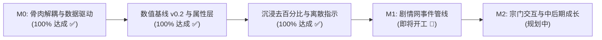
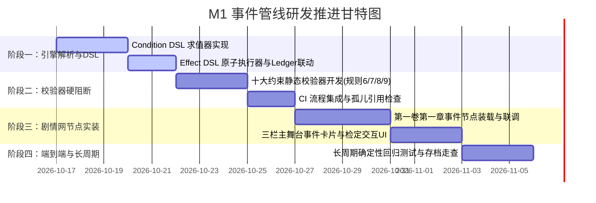

# 《修仙世界纪录簿》当前项目总进度与 M1 行动路线规划报告 v1

| 项目 | 内容 |
|---|---|
| **报告人** | Antigravity (Pair Programmer & Engine Implementer) |
| **收件人** | YY (Narrative Lead & Worldbuilder) / 小肥 (Game Designer & Reviewer) / 团队全体 |
| **日期** | 2026-10-16 |
| **基准仓库** | `Projects/Xiuxian-Game/` |
| **当前版本** | 引擎核心基线 v0.2 / M0 里程碑完成 / M1 事件管线启动前夕 |

---

## 1. 当前项目总进度全景盘点

截至 2026-10-16，经过 00 至 13 轮的技术审查、勘误对齐与高强度迭代重构，《修仙世界纪录簿》的基础工程架构已取得决定性突破，**M0 里程碑（骨肉分离与数据驱动）宣告 100% 圆满闭环**，全站技术防线与测试工程完备，完全具备迎接 M1 事件管线接入的条件。

### 1.1 核心里程碑达成清单



| 模块 / 规范 | 状态 | 核心成果与技术证据 |
|---|:---:|---|
| **M0 骨肉解耦** | ✅ **100% 完成** | 彻底剥离旧占位文本与硬编码数值，构建 `data/text/`（编剧文案）、`data/tuning/`（策划数值）、`data/items/`（物品字典）三权分立数据层；实现“策划改数值、编剧改文案，零动代码”准则。 |
| **双击即玩 (Zero-Setup)** | ✅ **100% 完成** | 编写 `scripts/build-data.js` 将散落 JSON 打包为 `data-bundle.js`，绕过 `file://` 跨域限制，保障玩家双击 `index.html` 即可畅玩，并具备 SHA-256 完整性防漂移核验。 |
| **受控 PRNG 确定性** | ✅ **100% 完成** | 根除全局裸 `Math.random()`（0 处残留），统一收口至带种子的 `nextRandom()`；通过 `tests/rng-determinism.test.js` 断言同种子 500 轮全等及存档断点完全复现。 |
| **数据标准与条目校验** | ✅ **100% 完成** | 全面执行 v0.2 数据标准；落实多维离散四轴关系模型（亲疏、信任、敬畏、戒惧）；实现 `inventory[]` 条目级强校验（必填 itemId/name/quantity/unit，严禁旧 count/id），静态与运行时双重防护。 |
| **数值基线与检定体系** | ✅ **100% 完成** | 确立六维检定属性（道行/灵力/神识/身法/悟性/心志）瞬时推导体系；明确大境界差距走 `requires` 条件门控而不进数值修正；锁定 DC 六档基线与修正总上限（±3）；确立 Hazard 必须事前预警（foreshadowed）硬规则。 |
| **界面修仙感去百分比** | ✅ **100% 完成** | 彻底消灭全局 `%` 字符（narration、html、客户端渲染 0 命中）；全面重构进度条为 3 段离散阶梯指示块（initial 1段 / marked 2段 / near 3段 / ready 金色全亮），根除设定集 26 禁止的“经验值刷条手感”。 |
| **缺陷清零与权威单源** | ✅ **100% 完成** | T1–T5 审查项全部闭环（T5 经 09 报告勘误撤销）；N1–N7 缺陷全数清零；彻底清除 `cultivationProgress`，确立 `progressInternal` 为全库唯一权威字段。 |

### 1.2 自动化测试工程矩阵（8 项全部通过）

项目建立了全自动化的回归防护网，覆盖从编译构建到运行时校验的全部路径：

```text
[scripts/validate-schema.js]         ✅ 静态 Schema 规范、反向必填与严禁字段检查 (4 条占位警告，0 错误)
[scripts/build-data.js --check]      ✅ data-bundle.js 与 JSON 源文件 SHA-256 哈希强同步
[tests/rng-determinism.test.js]      ✅ PRNG 500 轮确定性、存档续接复现、Math.random 0 调用
[tests/inventory-validation.test.js] ✅ 背包旧形状精准拦截报错、合规条目校验通过
[tests/cultivation-clamping.test.js] ✅ 修为上限改读 TUNING 驱动，max=200 零代码改动跟随生效
[tests/no-percentage-ui.test.js]     ✅ 文本 0 百分比、DOM 渲染路径无连续刷条、离散 3 段结构断言
[tests/economic-calibration.test.js] ✅ 3 个游戏日日常收支与账目平衡断言通过
[tests/progress-internal-authority]  ✅ progressInternal 唯一权威，清除双源并存与旧字段双重阻断
```

---

## 2. 当前挂起与外部依赖事项说明

在 M1 事件管线正式开工前，目前有两个处于**挂起待决 / 交付中**的事项，均已安全隔离，不阻碍核心引擎管线的推进：

### 2.1 事项一：经济手感最终裁定（YY 裁定中）
- **现状**：
  在《11》与《12》报告中，按小肥建议对齐了《16》基准（补气丸 2 灵石，日常任务 1–2 灵石）。3 个游戏日实测结果为：**收入 +5，支出 -5，期末结余 10（净变化 0）**。
- **裁定议题**：
  小肥指出“净变化 0 意味着玩家永远无法通过日常积累攒够修炼室费用（1–4 灵石）”。提出三种可能的手感方向：
  - **选项 A（如履薄冰）**：维持净 0，生存压力拉满，但可能导致中前期成长卡死；
  - **选项 B（缓慢积累）**：微调任务报酬至 `[2, 3]` 或降低生活成本，三日可攒 2–3 灵石；
  - **选项 C（推荐 · 靠事件开口子）**：日常维持净 0，而将灵石盈余作为偶发奇遇、任务重赏或人情往来的进项，契合设定集 34“资源阶段性卡关”的节奏。
- **当前处理**：
  **遵照 YY 指示，引擎端本轮暂不动经济参数，静候 YY 最终裁定**。待裁定明确后，仅需调整 `tuning.json` 即可秒级生效。

### 2.2 事项二：正史开局区域与正式人物卡（编剧侧交付中）
- **现状**：
  当前数据层中运行的是供联调测试用的骨架数据（`placeholder-starter.json`、`loc.placeholder-01`、`region.placeholder-01`、`npc.placeholder-guide`）。
- **后续依赖**：
  待 YY 交付临川镇正史开局设定与正式人物卡，引擎端直接替换 `data/` 下对应 JSON，并移除 `canon: false` 标记即可。

---

## 3. 下一步：M1 里程碑行动路线图（事件管线研发）

**M1 核心目标**：实现从“8 个独立基础行动卡片”向**“自编小说网状网状剧情驱动的事件管线系统（Event Pipeline）”**的全面演进。



### 3.1 阶段一：事件加载器与 DSL 解释引擎研发（预计 5 个工作日）
1. **事件数据目录规范**：
   在 `可运行测试第一版/data/` 下建立事件目录：
   ```
   data/events/
   ├── main/       ← 主线事件节点 (main.ch01.01.json 等)
   ├── side/       ← 支线事件节点 (side.ch01.xx.json 等)
   └── ambient/    ← 探索与环境偶发事件 (ambient.linchuan.xx.json 等)
   ```
2. **Condition DSL 解释器（`app.js`）**：
   - 编写纯逻辑求值器，支持 `all`、`any`、`not` 递归复合判断；
   - 支持比较操作符 `eq`, `ne`, `gt`, `gte`, `lt`, `lte`；
   - 支持修仙专用操作符：`flag`、`empty`（查空伤势）、`hasItem`（按 itemId 查背包）、`relationAxis`（四轴离散判定）、`locationIs`、`timeBetween`、`attrs`（动态推导六维属性）；
   - **红线**：禁止使用 `eval`；路径求值失败立即报错抛出异常。
3. **Effect DSL 原子执行器（`app.js`）**：
   - 实现 `stat.add`, `stat.set`, `currency.add`, `item.add`, `item.remove`, `relation.set`, `obligation.add`, `injury.add`, `time.advance`, `flag.set`；
   - 严格落实 §1.3 钳制原则：**生息量（疲劳/神识）允许钳制；资源量（灵石/物品）严禁负数钳制，越界即阻断**；
   - 每一次 Effect 执行后自动向 `ledger` 写入审计流水。

### 3.2 阶段二：校验器十大约束与 CI 硬阻断（预计 5 个工作日）
将《10 定稿》§4.4 的 10 项校验规则全面写入 `scripts/validate-schema.js`：
1. **规则 6（唯一性保护）**：同一 tick 下多个 `main` 节点同时满足激活条件时，**判定为静态编译错误**，禁止留在运行时随机消解；
2. **规则 7（Hazard 事前预警校验）**：`hazard.declared: true` 而 `hazard.foreshadowed: false` 时，**校验直接阻断报错**；普通检定严禁携带 hazard 字段；
3. **规则 8（Fail-Forward 失败推进校验）**：带有 `check` 的选项，其 `onFail` 必须提供合法的 `next` 或显式 `blockReason`，杜绝死胡同；
4. **规则 9（条目级复合结构校验）**：对所有新增事件引用的背包、货币、关系进行深度条目级字段反查；
5. **规则 5（软锁检测）**：检测每个节点必须有至少一个恒真选项或存在必填的 `defaultOutcome` 兜底。

### 3.3 阶段三：第一卷第一章节点实装与三栏交互呈现（预计 7 个工作日）
1. **剧情节点装载**：与编剧侧联调，正式载入第一卷第一章（临川镇初探、坊市冲突、后山遗迹、第一道生死抉择）的事件节点；
2. **三栏主舞台交互升级**：
   - 中栏增加**事件剧情情境卡（Scene Card）**与**检定判定卡（Check Card）**；
   - 选项显示条件门控置灰及原因（如“道行不足”、“灵力匮乏”）；
   - 掷骰检定交互：展示六维属性来源明细、修正项（上限 ±3）与 1d10 掷骰结果，支持大成功（自然 10）与普通大失败（自然 1）的分支演出。

### 3.4 阶段四：自动化回归测试与长周期存档推演（预计 3 个工作日）
- 编写长周期（10–30 游戏日）业务流自动化测试；
- 验证高频事件跳转后，PRNG 种子推进与快照恢复 100% 确定性吻合；
- 验证玩家浏览器关闭重开后，网状剧本状态与人脉关系网零漂移。

---

## 4. 团队工程协作指南

为保持多方协作的高效、严谨与透明，后续工作继续贯彻以下协作准则：

1. **查阅总纲以《14 总集编》为准**：
   新协作者或快速查阅标准，请直接参阅根目录下的 [**《14_全景技术规范与历次协作决议总集编(00-13合卷)_v1.md》**](./14_全景技术规范与历次协作决议总集编(00-13合卷)_v1.md)，无需从头翻阅 14 份历史文件。
2. **文档连续编号惯例**：
   后续所有新文档一律按入库顺序递增编号（当前已编号至 `15`，下一份为 `16_...`），禁止按作者各自编号，保障时间线清晰可溯。
3. **审阅抓取采用全量哈希工作流**：
   审阅端每次下载代码必须全量重下并运行比对，本地运行 `node scripts/build-data.js --check` 保证数据包一致。
4. **测试绿灯作为合并红线**：
   任何功能改动必须伴随自动化测试断言，`npm test`（或全部 8 个测试脚本）绿灯通过后方可合并至 `main` 分支。

---

*本报告已推送到 GitHub 远端主分支，作为 M0 胜利收官与 M1 正式启动的纲领性行动指南！*
