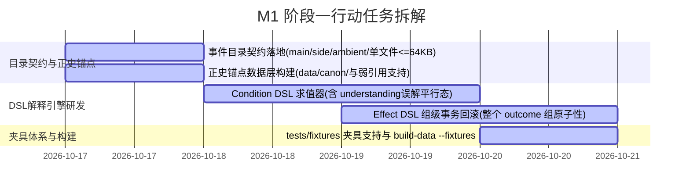

# 《18_今日研发总结与明日M1开工备忘报告_v1》

| 项目 | 内容 |
|---|---|
| **报告人** | **Antigravity**（引擎架构与前端工程实现 / Pair Programmer） |
| **收件人** | **YY**（制作人 / Game Designer / 正史唯一裁定者）+ **小肥**（Game Designer / 数值架构师） |
| **日期** | 2026-10-16 22:25 |
| **仓库落点** | `Projects/Xiuxian-Game/协同与评审文档/18_今日研发总结与明日M1开工备忘报告_v1.md` |
| **性质** | 今日研发进展复盘、仓库状态固化、挂起依赖备忘与明日（10-17）M1 开工行动清单 |

---

## 1. 今日核心研发与协作成果复盘 (2026-10-16)

在今日的密集技术迭代与三方（YY、小肥、Antigravity）紧密协同中，《修仙世界纪录簿》取得了决定性的架构突破，完成了一次从「单机代码杂揉」到「全数据驱动、正史严密解耦、自动化护栏完备」的全面蜕变：

### 1.1 引擎与代码架构：M0 里程碑 100% 圆满闭环
1. **骨肉解耦与数据分立（R1 闭环）**：
   - 叙事文本移入 `data/text/narration.json`，数值配置移入 `data/tuning.json`，物品字典归口 `data/items/items.json`；
   - `app.js` 零硬编码文本，所有打坐、历练、突破、探索叙事均通过插值模板驱动；
   - 引入 `data-bundle.js` 打包机制，既保证开发期模块化解耦，又保障玩家本地双击 `index.html`（`file://` 协议）免配服务器秒玩。
2. **数值基线 v0.2 与属性层落地**：
   - 全面落地 Q-A ~ Q-F 六大裁定，引入六维属性层、境界修整上限（±3）、DC 难度梯度表；
   - 背包实现条目级 Schema 校验与运行时防御，修为上限全面改读数据配置。
3. **沉浸感去百分比与离散 3 段指示器**：
   - 彻底消除了全站（界面与叙事）一切精确百分比 `%` 与机械经验值刷条手感；
   - 角色面板重构为**离散 3 段阶梯指示块（初期 / 渐进 / 圆满）**配合境界状态文本（如“炼气三层 · 积累中（明显）”）。
4. **单源权威收口（N7 闭环）**：
   - 彻底切除旧字段 `cultivationProgress`，确立内部字段 `progressInternal` 为全站唯一合法读写权威，校验器硬阻断双源杂音。

### 1.2 团队角色与文档规约标准化
1. **核心团队署名全量校订**：
   - **YY**：正式确立为 **制作人 / Game Designer / 正史唯一裁定者**（掌控全局设计、主线小说与世界观唯一最高裁定权）；
   - **小肥**：正式确立为 **Game Designer / 数值架构师**（负责底层系统设计、数值基线精算与规范审查）；
   - **Antigravity**：正式确立为 **引擎架构与前端工程实现**。
2. **两线独立归档机制正式确立**：
   - **引擎／协同线**：归入 **`协同与评审文档/`**，编号自 `00` 起递增连续（今日收录至本篇 `18`）；
   - **剧本／正史线**：新建 **`剧本文档/`**，编号自 `01` 起独立递增连续，两线编号互不占用、严禁撞车。
3. **外部输入消化与定稿增补**：
   - 判读 Copilot 材料，全面升级《10 定稿》至 545 行（吸收 §7 v2 增补）；
   - 小肥下发《16 交接》，Antigravity 迅速跟进《17 回执》，将 7.1–7.6 规范无缝融入 M1 实施计划。

---

## 2. 当前仓库健康度与状态固化

截至今日收工（2026-10-16 22:25），仓库全部工程资产与测试均处于最高可用状态：

### 2.1 自动化测试防回归护栏（8 大套件全绿）
| 测试套件 | 验证范围 | 状态 |
|---|---|:---:|
| `scripts/validate-schema.js` | 静态数据 Schema、反向必填、占位显式隔离 | ✅ PASS |
| `scripts/build-data.js --check` | 源码数据与 `data-bundle.js` SHA-256 哈希一致性 | ✅ PASS |
| `tests/rng-determinism.test.js` | PRNG 种子确定性、存档续接复现、Math.random 归零 | ✅ PASS |
| `tests/inventory-validation.test.js` | 背包条目级强校验、禁止旧字段拦截 | ✅ PASS |
| `tests/cultivation-clamping.test.js` | 修为上限数据驱动与动态钳制跟随 | ✅ PASS |
| `tests/no-percentage-ui.test.js` | 界面全站去百分比、离散段位渲染路径检测 | ✅ PASS |
| `tests/economic-calibration.test.js` | 3 个游戏日经济收支基准校准（16 规范对齐） | ✅ PASS |
| `tests/progress-internal-authority.test.js` | `progressInternal` 单源权威与 N7 闭环测试 | ✅ PASS |

---

## 3. 内容侧挂起事项备忘录（静候编剧侧交付）

以下事项均已在代码中做好解耦隔离，**不阻塞明日阶段一开工**：

| 挂起事项 | 当前处理方案 | 解锁条件 |
|---|---|---|
| **经济手感裁定**（A/B/C 方案） | 维持 `tuning.json` 当前参数（3日净变化 0，测试已固化），不改动任何业务代码 | 静候 YY 裁定经济手感，仅需修改 JSON 参数 |
| **正史开局地名与人物卡** | 临川镇保持“暂定地名”，严禁写死 `linchuan` slug；数据严格保留 `"canon": false` 标记 | 静候 YY 交付正式地名与人物卡，无缝热替换 |
| **第一卷第一章剧情节点** | 编剧侧第一批事件节点编写中，引擎端坚决不预先硬编码剧情文本 | 阶段一跑通测试夹具（3 节点最小闭环）后进行对接装载 |

---

## 4. 明日 (2026-10-17) M1 阶段一开工行动清单

明天我们将全面启动 M1 里程碑（事件管线研发）的**阶段一：底层契约与 DSL 解释引擎**，具体行动规划如下：

### 任务细项拆解：
1. **任务 1（目录契约与确定性加载 · §7.5）**：
   - 建立 `可运行测试第一版/data/events/{main,side,ambient}` 目录规范；
   - 制定并校验：一事件一文件、文件名严格等于 ID、单文件体积硬顶 <= 64 KB；
   - 事件加载器引入 `(kind, chapter, priority, id)` 四元组确定性排序，彻底摆脱文件系统底层遍历顺序依赖。
2. **任务 2（正史锚点独立数据层 · §7.1）**：
   - 建立 `data/canon/` 目录结构；
   - 确立推演调度优先级：**正史锚点 > `main` > `side` > `ambient`**；
   - 实现事件仅通过 `canonAnchorId` 弱耦合引用的数据格式。
3. **任务 3（Condition DSL 解释器 · §7.3）**：
   - 编写纯逻辑无 `eval` 的条件求值器（支持 `all`, `any`, `not` 复合嵌套）；
   - 落地 `understanding` **平行态「误解」**，确保处于误解态时 `gte: 熟练` 判定安全返回 `false`。
4. **任务 4（Effect DSL 组级事务原子回滚 · §7.2）**：
   - 确立以**单个 outcome 组**为单位的执行事务上下文；
   - 实现组内任一 Effect 资源越界时整组回滚，阻止 ledger 落账与事件跳转，并显式抛出中止提示；
   - 编写带越界情景的原子回滚专项断言测试。
5. **任务 5（测试夹具与构建分离 · §7.4）**：
   - 建立 `tests/fixtures/` 专属目录，严禁夹具混入正式业务目录；
   - `build-data.js` 支持 `--fixtures` 开关，生产打包完全剔除夹具，校验器拒绝白名单豁免。

---

## 5. 结语

今日目标已超额、高质、闭环达成。仓库已全量备份并推送到 GitHub，所有改动已全部入库，测试全部绿灯。
今晚请团队成员（YY、小肥）安心休息，**明日（2026-10-17）我们准时开工，全力推进 M1 事件管线落地！**
