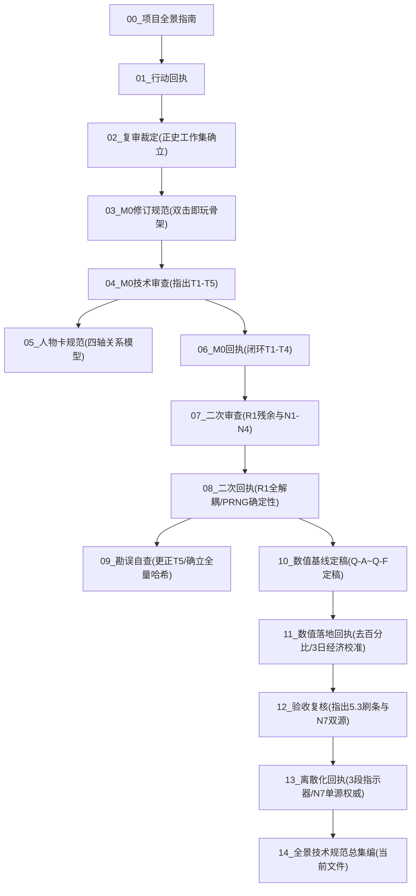

# 《修仙世界纪录簿》全景技术规范与历次协作决议总集编（00–13合卷）v1

| 项目 | 内容 |
|---|---|
| **编制方** | Antigravity (Pair Programmer & Engine Implementer) |
| **复核/裁定方** | YY (Narrative Lead & Worldbuilder & Game Designer) / 小肥 (Game Designer & Reviewer) |
| **涵盖源文件** | `00_项目全景与技术交接指南` 至 `13_进度条离散化与N7唯一权威闭环回执`（共 14 份协作文件） |
| **基准仓库** | `Projects/Xiuxian-Game/` |
| **定位** | **全项目唯一权威全景技术与规范手册**。任何新协作者、AI 助手或模块开发者只需精读本文档，即可全面掌握全部底层架构、正史边界、数据标准、数值基线、检定规则与工程验收红线。 |

---

## 目录

- [第一篇：工程架构与设计总纲](#第一篇工程架构与设计总纲)
- [第二篇：正史口径与内容解耦准则](#第二篇正史口径与内容解耦准则)
- [第三篇：角色卡规范与多维离散模型](#第三篇角色卡规范与多维离散模型)
- [第四篇：数值基线、检定属性与 DC 体系](#第四篇数值基线检定属性与-dc-体系)
- [第五篇：事件管线 Schema 与十大约束](#第五篇事件管线-schema-与十大约束)
- [第六篇：界面修仙感与去经验刷条规范](#第六篇界面修仙感与去经验刷条规范)
- [第七篇：历次协作决议追溯与缺陷闭环表](#第七篇历次协作决议追溯与缺陷闭环表)
- [第八篇：自动化测试工程与防回归护栏](#第八篇自动化测试工程与防回归护栏)

---

## 第一篇：工程架构与设计总纲

### 1.1 项目定位与核心原则
《修仙世界纪录簿》是一个基于原生 Web 标准构建的**轻量级、零运行时依赖、纯单机沉浸式文字修仙 RPG / 互动小说引擎**。
- **纯单机自闭环**：无需搭建后端服务，无需配置任何 API Key，离线天道推演引擎在客户端本地运行；
- **双击即玩（Zero-Setup）**：采用构建脚本将数据层打包为 `data-bundle.js` 挂载到 `window.XIUXIAN_DATA`，既绕过了浏览器直接双击打开本地 HTML（`file://` 协议）时的 Fetch/XHR 跨域限制，又严格保持了开发期 `data/*.json` 的独立解耦；
- **沉浸式单页布局**：零全局垂直滚动条，采用三栏自适应视口设计：
  - **左栏（角色面板）**：常驻展现主角道号、身份背景、修为境界（离散 3 段阶梯指示）、生息属性（精力疲劳、灵力负荷、神识）、灵石行囊与当前位置；
  - **中栏（主舞台与事件日志）**：自适应滚动，呈现天道行动播报、环境探索纪事、NPC 互动叙事与判定卡片；
  - **右栏/底部（行动决策区）**：八大基础行动卡片（修炼、探索、试炼、突破、休息、任务、商贸、结交），支持直接点击或自定义输入文本进行推演。

### 1.2 状态持久化与快照流转
- **单向数据流**：所有玩家行动产生 `charPatch` / `worldPatch`，通过严格的白名单校验后合并入全局 `state`；
- **Ledger 记账机制**：每一次数值变动、灵石收支或状态跃迁，均必须向 `state.ledger[]` 写入明细记录（包含 `before`、`change`、`after`、`reason` 以及是否被钳制 `clamped`），保障审计溯源与状态确定性；
- **PRNG 伪随机数全受控**：消除代码中一切裸 `Math.random()` 调用，统一收口至带种子的线性同余/乘法移位 PRNG（`nextRandom()`）。存档必须持久化保存 `rngSeed` 与 `rngCursor`，保障同种子完全复现与读档精确接续。

---

## 第二篇：正史口径与内容解耦准则

### 2.1 正史唯一裁定权（《02》文件确立）
- **正史裁定方**：世界观、正史人物、地域设定、宗门势力与主线剧情由 **YY 拥有唯一最高裁定权**；
- **正史基准库**：以 `xiuxian_working_v1.5/`（含 41 份策划与 GM 规则集）为准绳，严禁将原型初期的临时占位设定（如“陆青云”、“晨曦大陆”、“采药老叟”）当作正史；
- **占位符显式隔离**：在正史内容交付前，开发环境中的过渡数据必须显式标注 `"canon": false` 与 `"placeholder": true`，校验器识别后输出警告但不阻断运行。

### 2.2 骨肉分离法则（R1 解耦验收标准）
- **核心验收准则**：
  > **「策划修改数值、编剧替换文本、世界观整体移植，不需要修改任何 `.js` 代码文件。」**
- **三权分立数据层**：
  - `data/text/narration.json`：编剧层（YY负责），收录全部行动叙事、观察洞察、预设输入文案与建议流转，支持标准参数插值（`{location}`, `{currencyName}` 等）；
  - `data/tuning.json`：策划数值层（小肥负责），管理疲劳阈值、时间流速、产出区间、基准物价与境界档位；
  - `data/items/items.json`：物品数据字典，严格以机器 ID（如 `item.qi-pill`）注册标准名称、单位、分类与基准价值。

---

## 第三篇：角色卡规范与多维离散模型

### 3.1 角色数据标准 v0.2
依据《05 人物卡规范》与《10 定稿》，角色卡字段确立为：

| 字段路径 | 类型 / 取值 | 规范说明 | 约束红线 |
|---|---|---|---|
| `character.realm` | `{name, level, stage}` | 境界层级，如炼气三层 | 沿用 v0.1 |
| `character.realmStability` | enum | `unstable` / `stable` / `accumulating` / `ready` / `consolidating` | **必填**，反映根基稳固状态 |
| `character.progressBand` | enum \| null | `initial`（初步）/ `marked`（明显）/ `near`（接近） | 仅在 `accumulating` 时有值 |
| `character.progressInternal` | number \| null | 0 ~ `TUNING.cultivation.max`（默认 100） | **唯一权威内部数值**，禁止向玩家直接展示 |
| `character.cultivationScale` | object | `{display: false, unit: null}` | 显式声明该量表不对外输出 |
| `character.spiritualPower` | object | `{value, unit, controlState}` | 灵力现值与控制状态 |
| `character.fatigue` | object | `{value, scaleId, description}` | 精力疲劳，描述由 tuning 动态解析 |
| `character.soulLoad` | object | `{value, scaleId, description}` | 神识负荷（独立于外伤与疲劳） |
| `character.inventory[]` | array | 见 3.2 背包条目规范 | 条目级强制校验 |
| `character.currencyBalances[]`| array | `[{unit, amount}]` | 存储机器 ID 与非负整数金额 |
| `character.relationships[]` | array | 见 3.3 四轴离散关系规范 | 条目级强制校验 |
| `character.injuries[]` | array | 记录部位、类型、严重度、限制与恢复期 | 严重度 critical 无法靠普通睡眠自愈 |

### 3.2 背包条目规范（N6 闭环约束）
每一个 `inventory[]` 条目必须符合：
```jsonc
{
  "itemId": "item.qi-pill",    // 必填：必须已在 items.json 注册
  "name": "补气丸",            // 必填：展示名称
  "quantity": 2,              // 必填：非负整数（严禁负数，严禁越界钳制）
  "unit": "枚",               // 必填：展示单位
  "condition": "完好",         // 状态
  "ownerId": ""               // 归属
}
```
> ⚠️ **严禁字段**：条目中严禁出现旧字段 `count` 或 `id`，一旦出现，静态校验器与运行时 `validateState()` 将精准报错到 `inventory[index].itemId`。

### 3.3 多维离散四轴关系模型（《05》规范）
废除单一维度的“好感度数值”，正式采用离散多轴关系矩阵：
- **亲疏轴 (`affinity`)**：`cold`（冷淡） / `neutral`（中立） / `warm`（友善） / `close`（亲近）
- **信任轴 (`trust`)**：`suspicious`（多疑） / `wary`（戒备） / `trusting`（信任） / `reliant`（托付）
- **敬畏轴 (`respect`)**：`dismissive`（轻视） / `neutral`（平视） / `respectful`（敬重） / `reverent`（尊崇）
- **戒惧轴 (`fear`)**：`none`（无惧） / `wary`（忌惮） / `fearful`（畏惧）

### 3.4 严禁字段红线（Forbidden Fields）
- ❌ **全局生命值 `health` / `vitality`**：修仙者无血条概念，外伤统归 `injuries[]`，消耗统归 `fatigue` 与 `soulLoad`；
- ❌ **灵根数组 `spiritRoots`**：统一采用单字符串 `spiritualRoot`（如“四灵根”、“天灵根”）；
- ❌ **旧修为字段 `cultivationProgress`**：彻底废除，全库唯一权威为 `progressInternal`；
- ❌ **货币冗余字段 `currency`**：只存机器 ID `unit`，展示名由 `TUNING.currencies[unit].displayName` 动态渲染。

---

## 第四篇：数值基线、检定属性与 DC 体系

### 4.1 检定属性六维与动态推导（《10 定稿》§2）
检定属性是角色状态在判定时刻的**瞬时可计算投影，不独立持久化存储**，避免产生第二套真相：

| 属性 | 覆盖维度 | 取值范围 | 语义基准 | 推导依据 |
|---|---|:---:|---|---|
| `daohang` 道行 | 境界基准 | 1–5 | 1拙劣 2平平 3尚可 4出色 5卓绝 | 由 `realm` 查表（感气:1, 炼气前期:2, 炼气中期:3, 炼气后期:4, 筑基:5） |
| `lingli` 灵力 | 灵力基础 | 1–5 | 同上 | 灵力充盈率叠加 `controlState` 修正（紊乱-1，平稳+1） |
| `shenshi` 神识 | 神魂状态 | 1–5 | 同上 | `daohang` 基准按 `soulLoad` 衰减，叠加道心受损 flag |
| `shenfa` 身法 | 肉身协调 | 1–5 | 同上 | 由体质基准受 `injuries` 最高严重度衰减，再受高疲劳衰减 |
| `wuxing` 悟性 | 理解经验 | 1–5 | 同上 | `understanding` 深度与技艺数量权重，叠加灵根修正 |
| `xinzhi` 心志 | 道心意志 | 1–5 | 同上 | 心境 flag 推导（无 flag 默认基准为 3） |

### 4.2 大境界门控法则（Q-C 核心裁定）
- **大境界差距严禁转化为数值修正**：把“筑基 vs 炼气”压成一个 ±2 的修正会严重破坏修仙世界的战力真实感；
- **正确做法是走条件门控（`requires`）**：低境界修士面对高境界修士时，“正面强攻”等自杀式选项直接置灰或不出现；低境界破局必须依赖伏击、阵法、借势或逃脱等特定分支。

### 4.3 DC 六档难度表与修正上限
- **DC 难度分级**：轻而易举 (**5**) / 简单 (**7**) / 常规 (**9**) / 困难 (**11**) / 险峻 (**13**) / 近乎不可能 (**15**)
- **修正项约束**：环境、准备、伤势等单项修正均为 ±1，**全局修正总上限严格锁定在 ±3 以内**。超出部分不进判定修正，改走条件门控。

### 4.4 Q-E 危险检定（Hazard）硬规则
- **大失败（自然骰 1）默认绝对不直接产生重伤或死亡**；常规大失败代价仅限：耗费额外时间、额外灵石/道具损耗、疲劳加重或行踪暴露；
- **重伤/死亡的唯一合法条件**：该选项在数据中显式声明危险等级，且场景预先存在角色可察觉的风险提示：
  ```jsonc
  "check": {
    "stat": "attrs.shenfa", "dice": "1d10", "dc": 13,
    "hazard": {
      "declared": true,                  // 显式声明实质危险
      "foreshadowed": true,              // 【硬性红线】场景文本已提前提示风险
      "criticalFailSeverity": "severe",   // minor | restricting | severe | critical | lethal
      "criticalFailEffect": { "op": "injury.add", "id": "injury.fall", "severity": "severe" }
    }
  }
  ```
- ⚠️ **阻断规则**：`hazard.declared: true` 而 `hazard.foreshadowed: false` 时，校验器直接阻断报错；普通检定严禁滥带 `hazard` 字段；`lethal`（致死）选项必须提交 YY 逐一审查。

### 4.5 失败推进法则（Fail-Forward）
- 每一个带有检定 `check` 的选项，其 `onFail` 分支**必须给出合法的后续推进跳转 `next`**，或者显式声明失败理由 `blockReason`；严禁选项失败导致剧情中断或软锁死胡同。

---

## 第五篇：事件管线 Schema 与十大约束

### 5.1 事件节点标准结构（EventNode）
```jsonc
{
  "id": "main.ch01.01",              // 命名：main.ch<NN>.<NN> / side.ch<NN>.<NN> / ambient.<region>.<NN>
  "kind": "main",                    // main | side | ambient
  "title": "节点标题",
  "chapter": 1,
  "region": "region.linchuan",       // 外键：必须存在于 world.json
  "location": "loc.market",          // 外键：必须存在于 world.json
  "once": true,
  "activation": { /* Condition DSL */ },
  "scene": { "textKey": "main.ch01.01.scene" }, // 文本不内联，指向 data/text/
  "choices": [
    {
      "id": "choice-a",
      "labelKey": "main.ch01.01.a",
      "requires": { /* Condition DSL */ },
      "check": { /* 属性检定，可空 */ },
      "onSuccess": { "effects": [], "next": "main.ch01.02" },
      "onFail": { "effects": [], "next": "main.ch01.03" },
      "onCriticalSuccess": { "effects": [], "next": null },
      "onCriticalFail": { "effects": [], "next": null }
    }
  ],
  "defaultOutcome": { "effects": [], "next": "main.ch01.04" } // 【必填】全部 choice 不满足时的保底出口
}
```

### 5.2 Condition 与 Effect DSL 规约
- **Condition DSL**：禁止使用 JavaScript `eval`。仅支持白名单操作符：
  - 逻辑组：`all`, `any`, `not`；
  - 比较组：`eq`, `ne`, `gt`, `gte`, `lt`, `lte`；
  - 专用域：`flag`, `empty`, `hasItem`, `relationAxis`, `locationIs`, `attrs`。
- **Effect DSL**：采用具名原子操作符：
  - `stat.add` / `stat.set`（受钳制规则保护）；
  - `currency.add` / `item.add` / `item.remove`（**禁止负数，越界即报错，不钳制**）；
  - `relation.set`, `obligation.add`, `injury.add`, `time.advance`, `flag.set`。

### 5.3 校验器十大约束（静态编译与 CI 硬性阻断）
1. Schema 字段与类型校验，未知字段报错；
2. 全局 ID 唯一性与前缀命名规范；
3. **孤儿引用拦截**：`next`、`location`、`region`、`factionId`、`itemId`、`npcId` 必须存在对应注册表；
4. **不可达节点检测**；
5. **软锁检测**：节点必须有恒真选项或有效的 `defaultOutcome`；
6. 🚨 **同一 tick 多 main 节点命中**：判定为静态校验错误，禁止留到运行时隐式消解；
7. 🚨 **Hazard 事前风险预警校验**（§4.4）；
8. 🚨 **Fail-Forward 失败推进校验**（§4.5）；
9. 🚨 **条目级 Schema 校验**（背包、货币、关系）；
10. **悬空 flag 告警**。

---

## 第六篇：界面修仙感与去经验刷条规范

### 6.1 设定集 26 反对经验值刷条
修仙世界不是传统的数值打怪升级网游，境界积累属于生命层次的玄妙蜕变。设定集明文反对“单一数字代表能力”与“平滑刷进度条”。

### 6.2 界面全站去百分比（Q-A 硬验收）
- **叙事与界面 0 百分比**：`narration.json`、`index.html` 与客户端 UI 中，严格禁止向玩家展示 `%` 符号与具体进度点数；
- **自然语言境界徽标**：通过 `formatCultivationStatus` 将内部数值映射为纯正东方修仙表述：
  - `accumulating` + `initial` → **「炼气三层 · 积累中（初步）」**
  - `accumulating` + `marked` → **「炼气三层 · 积累中（明显）」**
  - `accumulating` + `near` → **「炼气三层 · 积累中（接近圆满）」**
  - `ready` → **「炼气三层 · 条件齐备（圆满）」**
  - `consolidating` → **「炼气四层 · 突破后待巩固」**
- **结算卡定性表述**：行动收益显示为“修为：有所精进”或“修为：略有领悟”，杜绝“修为 +8%”等网游化用语；
- **机器接口显式豁免**：AI 提示词模板生成器技术契约与开发者调试 JSON 导出属于机器接口，显式豁免于去百分比规则。

### 6.3 离散 3 段指示器架构（《12》复核与《13》落地）
- 彻底废除 `.progress-fill` 与 CSS `transition: width` 平滑填充；
- 采用 Flex 布局的 3 个独立 `.progress-segment` 离散块，仅根据离散档位点亮：
  - 1 段亮（初步）/ 2 段亮（明显）/ 3 段亮（接近圆满）；
  - 突破条件齐备时，3 段全亮并呈现金色光晕徽章（`.ready`）。

---

## 第七篇：历次协作决议追溯与缺陷闭环表

### 7.1 历次文档协作演进脉络



### 7.2 审阅工作流流程更正（《09 勘误》确立）
- 抓取远端必须**全量重下 + 逐文件 SHA-256 哈希比对**，严禁使用“只下载不存在新文件”的增量方式，杜绝因本地缓存引发的假缺陷误报；
- 引擎端每次构建必须执行 `node scripts/build-data.js --check` 保证数据包一致性。

### 7.3 缺陷全周期闭环追溯矩阵

| 缺陷编号 | 缺陷描述 | 触发审查 | 整改落地措施 | 验收结果与断言证据 |
|:---:|---|:---:|---|:---:|
| **T1** | `state-template` 字段形状与正史标准漂移 | 04 报告 | 重构数据模板，引入多维离散关系与动机字段 | ✅ 06 闭环，反向必填校验通过 |
| **T2** | 货币 `unit` 与单位 `displayUnit` 两义混淆 | 04 报告 | 拆分为 `unit`（机器键）与 `displayUnit`（展示名） | ✅ 06 闭环，静态与运行时校验通过 |
| **T3** | 防漂移校验机制缺失 | 04 报告 | 编写 `scripts/validate-schema.js` 实施全量静态检查 | ✅ 06 闭环，CI 阻断机制成立 |
| **T4** | 角色模型混入 `vitality` 字段 | 04 报告 | 清除全部活力字段，统一合并入 `fatigue` 与 `injuries` | ✅ 06 闭环，逆向必填拦截 |
| **T5** | 误判 M0 未开始 | 04 报告 | 09 报告查实系增量下载缓存问题，小肥主动出具勘误更正 | ✅ 09 撤回更正，建立哈希工作流 |
| **R1** | 叙事文本、物价与疲劳仍残留在 `app.js` | 07 报告 | 拆分为 `narration.json`、`tuning.json`、`items.json` | ✅ 08 闭环，反向改数据验证生效 |
| **N1** | 界面直接泄露机器货币 ID | 07 报告 | 统一通过 `TUNING.currencies[unit].displayName` 解析 | ✅ 08 闭环，界面全局无机器 ID |
| **N2** | 探索掉落写出废弃字段 `currency` | 07 报告 | 修正为标准 `{ unit, amount }` 形状 | ✅ 08 闭环，运行时强校验拦截 |
| **N3** | 提示词模板 schemaVersion 滞后 | 07 报告 | 同步更新为 `0.2` 规范契约 | ✅ 08 闭环，版本一致 |
| **N4** | `nextRandom()` 与 `Math.random()` 混用 | 07 报告 | 全面收口至 `nextRandom()`，裸随机归零 | ✅ 08 闭环，`rng-determinism.test.js` 通过 |
| **N5** | 背包写入用 `id` 而标准用 `itemId` | 09 报告 | 全量改为 `itemId`，去重与检索键同步收紧 | ✅ 11 闭环，无非标准字段 |
| **N6** | 背包条目无内部字段校验 | 09/10 报告 | 新增 `inventory[]` 条目级校验（必填 itemId/name/quantity/unit） | ✅ 11 闭环，`inventory-validation.test.js` 通过 |
| **5.1** | 修为上限硬编码 100 处 | 10 报告 | 改读 `TUNING.cultivation.max`，进度与钳制自适应跟随 | ✅ 11 闭环，`cultivation-clamping.test.js` 通过 |
| **5.3** | 界面去百分比仅完成文字，进度条仍为平滑刷条 | 12 报告 | 彻底废弃连续平滑条，重构为 3 段离散阶梯指示块 | ✅ 13 闭环，`no-percentage-ui.test.js` 扩展通过 |
| **N7** | `cultivationProgress` 与 `progressInternal` 双源并存 | 12 报告 | 彻底清除旧字段，确立 `progressInternal` 为唯一权威 | ✅ 13 闭环，`progress-internal-authority.test.js` 通过 |

---

## 第八篇：自动化测试工程与防回归护栏

项目当前构建了完整的自动化测试工程防线，在本地及 CI 流程中执行 8 大专项测试套件：

```text
Projects/Xiuxian-Game/
├── scripts/
│   ├── validate-schema.js               ← 静态数据规范与反向必填校验器 (PASSED)
│   └── build-data.js --check            ← 数据捆绑包与散落 JSON 一致性哈希断言 (PASSED)
└── tests/
    ├── rng-determinism.test.js          ← PRNG 确定性、存档续接与 Math.random() 0 调用断言 (PASSED)
    ├── inventory-validation.test.js     ← inventory 条目级强校验与精准报错断言 (PASSED)
    ├── cultivation-clamping.test.js     ← 修为上限 TUNING 数据驱动零改动跟随断言 (PASSED)
    ├── no-percentage-ui.test.js         ← 全站文本 0 百分比 & 渲染路径无经验刷条断言 (PASSED)
    ├── economic-calibration.test.js     ← 3 游戏日散修日常收支模拟与账目平衡断言 (PASSED)
    └── progress-internal-authority.test.js ← progressInternal 唯一权威与旧字段双重阻断断言 (PASSED)
```

**运行指令**：
```bash
node scripts/validate-schema.js
node scripts/build-data.js --check
node tests/rng-determinism.test.js
node tests/inventory-validation.test.js
node tests/cultivation-clamping.test.js
node tests/no-percentage-ui.test.js
node tests/economic-calibration.test.js
node tests/progress-internal-authority.test.js
```
所有测试当前全部绿灯通过，为后续 M1 事件管线建设奠定了坚如磐石的代码质量根基。
